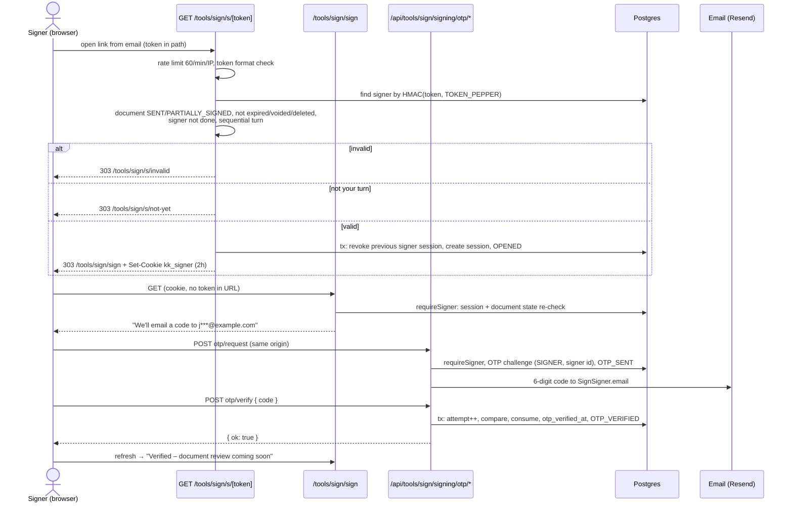

# Customer authentication — KarmaKoders Sign

Senders (product customers) sign in with an emailed one-time code. Customer auth is completely separate from the CMS staff login (NextAuth) — see [ADR 006](./adr/006-passwordless-otp.md) and [ADR 008](./adr/008-customer-auth-separate-from-cms.md). Signers never have accounts: they get a link token, a short signer session and an email code — see [Signer access](#signer-access).

All routes below return **404 while `SIGN_APP_ENABLED` is not `"true"`** (launch switch, [ENV.md](./ENV.md)).

## Code map

| Concern | Where |
|---|---|
| Sessions, cookie, `getCurrentCustomer`, `requireCustomer`, revoke | `src/platform/auth/session.ts`, `constants.ts`, `crypto.ts` |
| OTP request / verify | `src/platform/auth/otp.ts` |
| Safe post-login redirects | `src/platform/auth/redirect.ts` |
| `GET me` profile (field whitelist) | `src/platform/auth/profile.ts` |
| CSRF origin check | `src/platform/security/origin.ts` |
| Route wrapper (launch switch + CSRF + error mapping) | `src/modules/sign/launch/route.ts` (`signApiRoute`) |
| Rate limits | `src/platform/rate-limit` |
| Signed-out redirect for app pages | `src/proxy.ts` |
| Login UI / dashboard | `src/app/tools/sign/(app)/login`, `src/app/tools/sign/(workspace)/dashboard` |
| Owner-scoped document access (`getDocumentForOwner`, `listDocumentsForOwner`) | `src/modules/sign/documents/access.ts` |
| Signer link tokens, access rules | `src/modules/sign/signing/signer-access.ts`, `constants.ts` |
| Signer sessions, `requireSigner` | `src/modules/sign/signing/signer-session.ts` |
| Signer OTP | `src/modules/sign/signing/signer-otp.ts`, on the OTP core in `src/platform/auth/otp.ts` |
| Link exchange and signer pages | `src/app/tools/sign/(signer)/s/[token]/route.ts`, `(signer)/sign`, `(signer)/s/invalid`, `(signer)/s/not-yet` |
| Signer OTP APIs | `src/app/api/tools/sign/signing/otp/{request,verify}` |
| Evidence events | `src/platform/audit` (`appendAuditEvent`) |

## Sign-in flow

1. `POST /api/platform/auth/otp/request` `{ email }` — always `{ ok: true }` for a valid email (no account enumeration). Creates a 6-digit code (stored as an HMAC bound to email + purpose, 10-minute TTL) and invalidates older unused codes for that email, then emails the code via Resend.
2. `POST /api/platform/auth/otp/verify` `{ email, code }` — one DB transaction: conditional attempt increment (max **5** per code), constant-time hash compare, conditional consume, customer upsert, new session. Two concurrent verifies with the right code produce exactly one session. Every failure returns the same message.
3. The response sets the session cookie; the login page redirects to `safeNextPath(next)`.

Other routes: `POST logout` (this session), `POST logout-all` (every session of the customer), `GET me` (`id`, `email`, `name`, `creditsBalance`, active subscriptions — parsed through a zod whitelist, so hashes, tokens and Paddle ids can never leak).

## Sessions

| Property | Value |
|---|---|
| Token | 32 random bytes, base64url (`crypto.randomBytes`). Shown to the browser only. |
| Storage | `platform_sessions.token_hash` = HMAC-SHA256(token, `SESSION_SECRET`). The raw token is never stored or logged. |
| New on login | Every successful verify creates a brand-new session and token; tokens are never reused or rotated into. |
| Idle expiry | 30 days, **sliding**: `lastSeenAt`/`expiresAt` are refreshed at most **once per hour** (conditional `updateMany`, so concurrent requests don't all write). |
| Absolute limit | 90 days from `createdAt`, regardless of activity. `expiresAt` is never extended past it, and sessions older than 90 days are rejected. |
| Validation | `getCurrentCustomer()` (React `cache()`, once per request) checks cookie → hash lookup → `revokedAt` → `expiresAt` → 90-day cap → customer `status = ACTIVE`. Anything else is "signed out". |
| Revocation | `revokeSession()` (logout) and `revokeAllSessions(customerId)` (logout everywhere) set `revokedAt`; checks are server-side, so revocation takes effect on the next request. |
| Pages | `requireCustomer({ redirectToLoginFrom: path })` → redirect to `/tools/sign/login?next=<path>`. |
| APIs / Server Actions | `requireCustomer()` → 401 JSON via `toHttpError`. |

## Cookie

| Attribute | Production | Development / test |
|---|---|---|
| Name | `__Host-kk_session` | `kk_session` |
| HttpOnly | yes | yes |
| Secure | yes | no (localhost is plain HTTP) |
| SameSite | Lax | Lax |
| Path | `/` | `/` |
| Domain | none | none |
| Max-Age | 90 days (the absolute cap; the server enforces the 30-day idle window) | same |

The `__Host-` prefix makes the browser refuse the cookie unless it is Secure, `Path=/` and has no `Domain`, so a subdomain or an HTTP response can't plant or overwrite it. It never shares a name with the NextAuth staff cookie.

## Rate limits

Upstash sliding window via `src/platform/rate-limit`. In-memory only in development/test; in production missing Upstash config throws and Upstash errors **fail closed** (deny).

| Route | Limit |
|---|---|
| `otp/request` | 3 per 10 minutes per email **and** 10 per hour per IP |
| `otp/verify` | 20 per hour per IP; plus at most 5 attempts per code (in the DB) |

A blocked request gets **429**, `code: "rate_limited"`, a friendly message and `Retry-After` (seconds, the longest wait among the limits hit). For the Upstash sliding window it is the end of the current window rounded up plus 1 s, so a client that retries exactly at `Retry-After` is never refused again (`slidingWindowRetryAfterSec`). Every `/api/platform/auth/*` and `/api/tools/sign/*` response carries `Cache-Control: no-store` (set once in `signApiRoute`).

**Client IP.** `x-forwarded-for` (first entry), else `x-real-ip`. On Vercel every request passes through Vercel's edge, which overwrites these headers with the real client IP, so a client cannot spoof them to dodge per-IP limits. Outside Vercel they are client-controlled — acceptable only for development/test.

## CSRF

`assertSameOrigin(request)` requires the browser's `Origin` header (falling back to the `Referer` origin) to **exactly** match an allowed origin; a missing or `null` origin is rejected with 403.

Allowed origins:

- `APP_URL` (`https://www.karmakoders.com` in production)
- this deployment's own Vercel preview URLs (`VERCEL_URL`, `VERCEL_BRANCH_URL`) when `VERCEL_ENV=preview` — no `*.vercel.app` wildcard
- `ALLOWED_ORIGINS_EXTRA`: optional comma-separated **https** origins (scheme + host, no path), e.g. a staging server outside Vercel. Validated with zod at first use; `http` only for localhost in development; empty entries ignored; an invalid entry fails loudly instead of being skipped. Nothing else (including `staging.karmakoders.com`) is allowed unless listed.
- `http://localhost:3000` only when `NODE_ENV=development`

Applied by `signApiRoute()` to every POST/PUT/PATCH/DELETE under `/api/platform/*` (and, when they are added, `/api/tools/sign/*` — new routes must use `signApiRoute`), and called directly in data-changing Server Actions (early access, dashboard logout). **Webhooks are excluded** (the future Paddle webhook verifies its signature instead and must not use `signApiRoute`). SameSite=Lax on the cookie is a second layer.

## Redirects

`safeNextPath(next)` accepts only paths that, after up to three rounds of URL-decoding, start with `/tools/sign/`, contain no `//`, no backslash, no control characters and no scheme, and still resolve under `/tools/sign/` after `..` normalisation. It never returns the login page itself. Anything else → `/tools/sign/dashboard`. Fully percent-encoded paths are rejected (Next.js already decodes `searchParams` once).

`src/proxy.ts` sends signed-out visitors of `/tools/sign/dashboard`, `/new/*`, `/documents/*`, `/billing` and `/settings` to `/tools/sign/login?next=<path>` based on **cookie presence only** (cheap, no DB); every page and handler still calls `requireCustomer()` — the proxy is not the security boundary. The launch-switch 404 is applied first; `/admin` is unaffected.

## Threat model

| Threat | Mitigation |
|---|---|
| **Stolen session cookie** | HttpOnly (no JS access), Secure + `__Host-` in production, SameSite=Lax. Only the HMAC is stored, so a DB leak yields no usable cookies. 30-day idle / 90-day absolute expiry. "Log out of all devices" revokes every session server-side immediately. Suspended customers are rejected on every request. |
| **Brute force of codes** | 6-digit code, 10-minute TTL, max 5 attempts per code enforced atomically in the DB (conditional increment), 20 verifies per hour per IP, constant-time compare, requesting a new code invalidates the old one. |
| **Email bombing** (flooding someone's inbox with codes) | 3 code requests per 10 minutes per email and 10 per hour per IP; production rate limiting fails closed if Upstash is down. |
| **Open redirect** via `next` | `safeNextPath`: only `/tools/sign/…` paths after full decoding and normalisation; schemes, `//`, backslashes, control characters and traversal are rejected; default dashboard. |
| **CSRF** | Exact Origin/Referer allow-list on every mutating route and Server Action; missing Origin rejected; SameSite=Lax cookie; JSON bodies. |
| **Account enumeration** | `otp/request` answers identically whether or not the email has an account; `otp/verify` returns one generic error for every failure (unknown email, wrong, expired, exhausted or already-used code); precise reasons are only logged server-side with the email masked. |
| **Session fixation** | Sessions are created only after a successful verify, with a fresh random token; the server never accepts a client-chosen token (it must match a stored HMAC), and `__Host-` blocks subdomains from planting a cookie. |

## Document authorization (senders)

Every Sign API route, page and Server Action that reads or changes a document goes through `src/modules/sign/documents/access.ts`:

- `getDocumentForOwner(customerId, documentId)` returns the document only if `ownerId` matches and `deletedAt` is null. Otherwise it throws `NotFoundError` → **404, never 403**, so other people's documents are never revealed to exist. Malformed ids are rejected without a query.
- `listDocumentsForOwner(customerId, { status?, cursor?, limit })` returns the owner's non-deleted documents, newest first, with keyset pagination on the UUID v7 id (`limit` 1–100, default 20) and summary fields only.

`src/modules/sign/access-boundary.test.ts` fails if any file under `src/app/tools/sign` or `src/app/api/tools/sign`, or any Sign Server Action, queries `signDocument` / `signSigner` / `signSignerSession` through Prisma directly.

## Signer access

Signers have no account. Access is: **emailed link token → short signer session → email OTP** (→ consent and signature in a later step). All signer routes return **404 while `SIGN_APP_ENABLED` is not `"true"`**.

### Link token

| Property | Value |
|---|---|
| Format | 32 random bytes, base64url = exactly 43 characters `[A-Za-z0-9_-]` (`createSignerToken()`). |
| Storage | `sign_signers.token_hash` = HMAC-SHA256(token, `TOKEN_PEPPER`). The raw token goes only into the email link; it is never stored, logged, audited or sent to analytics. |
| Resolution | `resolveSignerToken(token)`: wrong length or characters → rejected **without a DB query**; then lookup by hash + constant-time compare. |
| Valid when | Document `SENT` or `PARTIALLY_SIGNED`; not expired (`expires_at`), voided or deleted; this signer has neither signed nor declined. |
| Sequential order | Valid only once every signer with a lower `order` has signed. Otherwise the distinct "not your turn yet" result, which is only reported when the link is otherwise valid. |
| Failure | One generic "This link is invalid or has expired" result for everything else. The precise reason is logged server-side with the signer id only. |

### Link exchange — `GET /tools/sign/s/[token]`

This is a route handler, not a page:

1. Rate limit: **60 per minute per IP** (Upstash; fails closed in production).
2. `resolveSignerToken`.
3. In one transaction: revoke the browser's previous signer session (if any), create the new one and append the `OPENED` audit event (actor `SIGNER`, ip, user agent).
4. Set the cookie and **303 to `/tools/sign/sign`**, so the token is not in the URL.

An invalid link gets a 303 to `/tools/sign/s/invalid` ("This link is no longer valid" plus the support email). A signer whose turn hasn't come gets a 303 to `/tools/sign/s/not-yet`.

Every response on `/tools/sign/s/*` and `/tools/sign/sign/*` has `X-Robots-Tag: noindex, nofollow`, `Referrer-Policy: no-referrer` and `Cache-Control: no-store` (set by the route handler and `next.config.ts`). The pages also carry noindex and no-referrer metadata. Both prefixes are in `SENSITIVE_PATH_PREFIXES`, so site-wide analytics and widgets skip them.

### Signer session

| Property | Value |
|---|---|
| Cookie | `__Host-kk_signer` (production) / `kk_signer` (development, test). HttpOnly, Secure in production, SameSite=Lax, Path=/, no Domain, Max-Age 2 hours. |
| Storage | Its own table, `sign_signer_sessions`: `signer_id`, `document_id`, `token_hash`, `expires_at`, ip, user agent, `revoked_at`. `token_hash` = HMAC-SHA256(value, `SESSION_SECRET`) with a `signer-session:` prefix, distinct from customer sessions. |
| Lifetime | Fixed **2 hours** from the exchange; no sliding refresh. Reopening the email link starts a new session. |
| One per browser | A new exchange revokes the session behind the browser's current signer cookie and overwrites the cookie. |
| Validation | `getCurrentSigner()` / `requireSigner()`: cookie format → hash lookup → not revoked, not expired → session, signer and document ids agree → **the same document-state rules as the link, re-checked on every call**. A document voided, expired or deleted after the cookie was issued is rejected. |
| Pages | `/tools/sign/sign` shows "Your signing session has expired — reopen the link from your email" when there is no valid session. |
| APIs | `/api/tools/sign/signing/*`: `requireSigner()` → 401. `requireSigner({ documentId })` also rejects a session for a different document, so a cookie for document A can't reach B. |

Why a separate table rather than `platform_sessions` with a type column:

- `platform_sessions.customer_id` is NOT NULL with an FK to customers, and making it nullable would change an existing column.
- Platform tables must not reference Sign tables.
- Keeping the two lifetimes (90-day sliding vs 2-hour fixed) on separate query paths means a bug in one check can't turn a signer cookie into a customer session.

### Signer OTP

`/tools/sign/sign` shows "We'll email a code to j***@example.com" until `sign_signers.otp_verified_at` is set. The address is always `SignSigner.email`, and the request body is ignored, so the signer can't send the code anywhere else.

- `POST /api/tools/sign/signing/otp/request` → `requestSignerOtp`: purpose `SIGNER`, challenge scoped to the signer id (the same person signing two documents has independent codes), audit event `OTP_SENT`.
- `POST /api/tools/sign/signing/otp/verify` `{ code }` → `verifySignerOtp`: the same hardened transaction as sender login (`verifyOtpChallenge`: conditional attempt increment with max 5 per code, constant-time compare, conditional consume). On success, in the same transaction, `otp_verified_at` is set only if still null, and only then is `OTP_VERIFIED` appended, so concurrent correct verifies record exactly one event. A signer OTP never creates a customer or a `kk_session`.
- Both routes use `signApiRoute` (launch switch + `assertSameOrigin` on POST) and the login limits: request 3 per 10 minutes per email and 10 per hour per IP; verify 20 per hour per IP. They use their own `otp:signer:*` rate-limit keys.

### Evidence

`appendAuditEvent` (`src/platform/audit`) locks the document row, assigns the next gap-free `sequence`, sets `prev_hash`, and computes `hash` = SHA-256 over the canonical event fields + `prev_hash`. Metadata keys with sensitive names (`token`, `code`, `otp`, `secret`, …) throw, so link tokens and OTP codes can't become evidence. Signer access writes `OPENED`, `OTP_SENT` and `OTP_VERIFIED`.

### Sequence: email link to OTP verified

### Signer threat model

| Threat | Mitigation |
|---|---|
| **Link forwarding** (the email is forwarded, or the link is shared) | The link alone only opens a session. Reviewing and signing require the OTP sent to the signer's own address, which the signer can't change. Sessions last 2 hours and are bound to one signer and one document. |
| **Token leakage via Referer** | `Referrer-Policy: no-referrer` (header and metadata) on the link and signer pages. The token is removed from the URL by an immediate 303, so later pages never carry it. |
| **Token leakage via history, caches, logs and analytics** | The 303 to a clean URL keeps the token out of later navigation. `Cache-Control: no-store`. The token is never logged (errors log only their name), audited, stored raw or put in metadata. Analytics and marketing widgets skip `SENSITIVE_PATH_PREFIXES`, and every signer page is noindex. Only the HMAC is stored, so a DB leak yields no usable links. **Residual risk:** the hosting platform's request logs record the path of the first GET. This is limited because the token is useless without the OTP and stops working once the signer signs or the document ends. |
| **Replay after void, expiry or completion** | The document and signer state is checked at the exchange **and re-checked on every `requireSigner()` call**. A link or cookie stops working as soon as the document is voided, expires, is deleted or completes, or the signer signs or declines. |
| **Out-of-order signing** | Sequential documents: the link is accepted only when every lower-order signer has signed ("not your turn yet" otherwise). |
| **Cross-document access** | A session row stores both the signer and the document. `requireSigner({ documentId })` rejects any other document, and the ids must agree with the signer row. |
| **Token guessing / brute force** | 256-bit random tokens. Malformed tokens are rejected without a query. 60 resolutions per minute per IP, failing closed in production. |
| **Email link scanners** (security gateways that pre-open links) | They can open a session and create an `OPENED` event, but can't pass the OTP. `OPENED` means "link opened", not "viewed by the signer". |
| **Session fixation / cookie planting** | Sessions are created only by a successful exchange, with a fresh random value. `__Host-` blocks subdomains from planting a cookie. A new exchange revokes the browser's previous session. |

## Not in scope here

- The OTP email itself (Resend, template and subject) is unchanged from the tested implementation in `src/platform/email`.
- Document review, e-sign consent, signature capture, decline and link passwords (`sign_documents.link_password_hash`) come with the signing screens.
